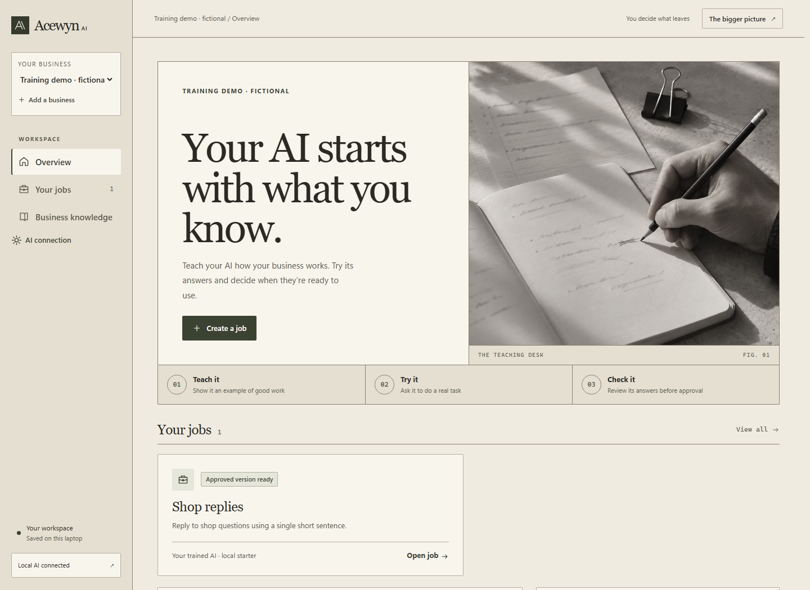

# Acewyn AI

**Business AI that learns from your team's examples.**

Acewyn AI helps people turn their expertise into AI they can teach, check, and control. Describe a job, show examples of good work, correct mistakes, and compare the model's answers before deciding what to use.

The product is designed for ordinary business users. Each business can start from a shared open-weight base model and keep its own examples, checks, and trained adapters.

> **Development status — November 6, 2026**
>
> The source includes the redesigned workbench, real per-business CPU training, and free Colab notebook preparation, result import, and comparison. Two real T4 training results have been verified and imported. Larger Colab adapters currently support comparison and export; using them for fresh questions inside the app is the next milestone.



## What is available

| Capability | Status |
| --- | --- |
| Business workspaces, job instructions, teaching examples, and corrections | Available |
| Local Ollama answers and reference notes | Available |
| Separate check questions, human review, approved versions, and rollback | Available |
| Workspace data and configuration export | Available |
| Per-business CPU LoRA training and trained-adapter export | Implemented and tested |
| Local trained-model use in Try it | Implemented for the small CPU starter |
| Free Colab notebook preparation, GPU training, result import, and comparison | Verified with real T4 runs |
| Ivory and olive interface with serif headings and responsive ruled layouts | Implemented and browser-checked |

## Run the prototype

Requirements are Windows, Python 3.11 or later, and Ollama for local AI answers.

1. Clone or download this repository and keep the folder together.
2. Double-click **START.cmd**. On the first run, it uses a working Python environment or starts **SETUP.cmd** automatically.
3. Open Ollama. Run **INSTALL LOCAL MODEL.cmd** if you need a local model.
4. Return to the app after the model download finishes.
5. Open [the local app](http://127.0.0.1:8765) and choose **Explore a sample business**, or create a workspace.

Initial setup and model downloads need an internet connection. The sample business uses fictional shop policies.

Inside a job, the workflow is:

1. **Teach it** — explain the job and add examples of the answers you want.
2. **Try it** — ask a real question and correct the answer when needed.
3. **Check it** — use different questions and review the actual answers.
4. **Versions** — approve a checked draft and return to an earlier approved version when needed.

Teaching examples can guide an Ollama model through its prompt. **Train it** turns reviewed examples into a real business-specific model update.

## Actual model training

The app supports two training paths.

### Train on your laptop

The small CPU starter uses `HuggingFaceTB/SmolLM2-135M-Instruct` with a separate LoRA adapter for each business job.

1. Add at least three teaching examples and one separate check.
2. In **Train it**, set up local training once.
3. Choose **Train my AI** and confirm permission to use the examples.
4. Compare the original model's answers with the saved adapter's answers.
5. Review each trained answer. When every answer looks right and the examples are current, choose **Use this training**.
6. Try the selected model, run checks, and approve a version.

Training runs on the laptop. Downloads include the adapter, frozen training data, checks, configuration, and an independent runner. The runner obtains the pinned public base model separately.

### Train with a free Colab GPU

The larger-model path uses `Qwen/Qwen3-4B-Instruct-2507` on an available free Google Colab T4.

1. In **Train it → Train in Colab**, choose **Prepare notebook**.
2. Confirm permission to share the job instructions, teaching examples, and check questions with Google Colab.
3. Upload the downloaded notebook to Colab.
4. Choose **Runtime → Change runtime type → T4 GPU**, then **Runtime → Run all**.
5. Save `acewyn-colab-adapter.zip` and return to the same job in Acewyn AI.
6. Choose **Import result** to see the before and after answers alongside your expected answers.

Expected check answers and reference files stay in the local app. Training uses a frozen snapshot, so editing a draft preserves the earlier run for comparison.

The importer checks the result's request identity, pinned base model, configuration, checks, artifact hashes, completed steps, and adapter tensor structure. Accepted ZIPs are limited to 64 MiB.

Free GPU availability varies. Stay on the free runtime and try again later if it is unavailable. The workflow runs interactively in Colab.

**Colab adapters currently support comparison and export.** Running them independently requires a compatible CUDA GPU. Connecting these larger adapters to **Try it** on a laptop is the next serving milestone.

## Verified training results

Two runs on November 3, 2026 used fictional shop data and a free Tesla T4. Both results were verified and imported into the app.

| Run | Teaching examples | Training steps | Separate checks | Changed adapter parameters |
| --- | --- | --- | --- | --- |
| Initial shop training | 6 | 18 | 2 | 2,949,120 |
| Delivery improvement | 12 | 36 | The same 2 | 2,949,120 |

For the delivery question, “How many days should I allow for delivery?”, the expected answer was five working days.

| Stage | Actual answer |
| --- | --- |
| Original base model | Delivery times vary by location and service; check the specific shop's policy for exact estimates. |
| First trained adapter | Delivery takes 3-5 working days. |
| Retrained adapter | Standard delivery takes five working days. |

The retrained adapter also answered the separate receipt question with “A receipt is required for returns.”

These runs demonstrate the teaching, training, comparison, and import workflow. The two reused checks provide limited quality evidence. Human reviews remain pending, and broader task quality needs fresh evaluation questions.

## Interface

The interface combines warm ivory and muted olive colors, large serif headings, fine dividing rules, and an original notebook photograph. The overview, job navigation, forms, training comparisons, and dialogs share the same visual language.

Desktop and 360/390-pixel phone layouts were checked, including workspace navigation, keyboard dialog controls, and the saved Colab comparisons.

## Technical stack

- **Application** — Python, FastAPI, and SQLite.
- **Interface** — HTML, CSS, and JavaScript modules.
- **Local inference** — Ollama, plus the trained CPU starter.
- **Training** — PyTorch, Transformers, PEFT, and LoRA.
- **Local starter base** — SmolLM2-135M-Instruct, pinned to revision `12fd25f77366fa6b3b4b768ec3050bf629380bac`.
- **GPU base** — Qwen3-4B-Instruct-2507, pinned to revision `cdbee75f17c01a7cc42f958dc650907174af0554`.
- **GPU execution** — interactive Colab notebooks. An optional Modal integration is implemented, with its first real L4 training run still pending.

## Data and privacy

The app stores business data in `data/own.sqlite3` and binds to `127.0.0.1`. It is a single-owner local prototype. Workspaces separate records inside that app, and production multi-user authentication and business-data encryption remain future work.

Local inference and CPU training run on the laptop. Uploading a training notebook to Colab shares its included data with Google. The optional Modal path requires separate data-transfer and spending confirmations.

Workspace exports, training notebooks, and trained-model downloads can contain private business data. Keep them private. Workspace data import is still a future feature; Colab model-result import is available in **Train it**.

Local datasets, credentials, downloaded base models, and trained weights are excluded from Git.

## Testing

The prototype passed **99 automated tests**, with separate browser checks for the Colab import flow and redesigned interface. Controlled test fixtures are separate from the real T4 runs described above.

To run the Python suite:

```text
python -m pip install -r requirements-dev.txt
python -m unittest discover -s tests -v
node --check web/app.js
node --check web/training.js
node --check web/gpu.js
```

The Colab browser regression in `tests/browser/colab-training.cjs` uses a temporary local app and synthetic adapter fixtures.

## Next milestones

- Make the imported larger model usable for fresh questions in **Try it**.
- Expand independent evaluations and task coverage.
- Add broader deployment options, base-model migration, and production access controls.

The longer-term goal is to turn business workflows into evaluations, expertise into training data, and production corrections into improvements that survive changes of base model.

## References

- [YC's request for startups](https://www.ycombinator.com/rfs)
- [Ollama documentation](https://docs.ollama.com/)
- [SmolLM2 starter model](https://huggingface.co/HuggingFaceTB/SmolLM2-135M-Instruct)
- [Qwen GPU base model](https://huggingface.co/Qwen/Qwen3-4B-Instruct-2507)
- [PEFT adapter format](https://huggingface.co/docs/peft/developer_guides/checkpoint)
- [Google Colab FAQ and resource limits](https://research.google.com/colaboratory/faq.html)
