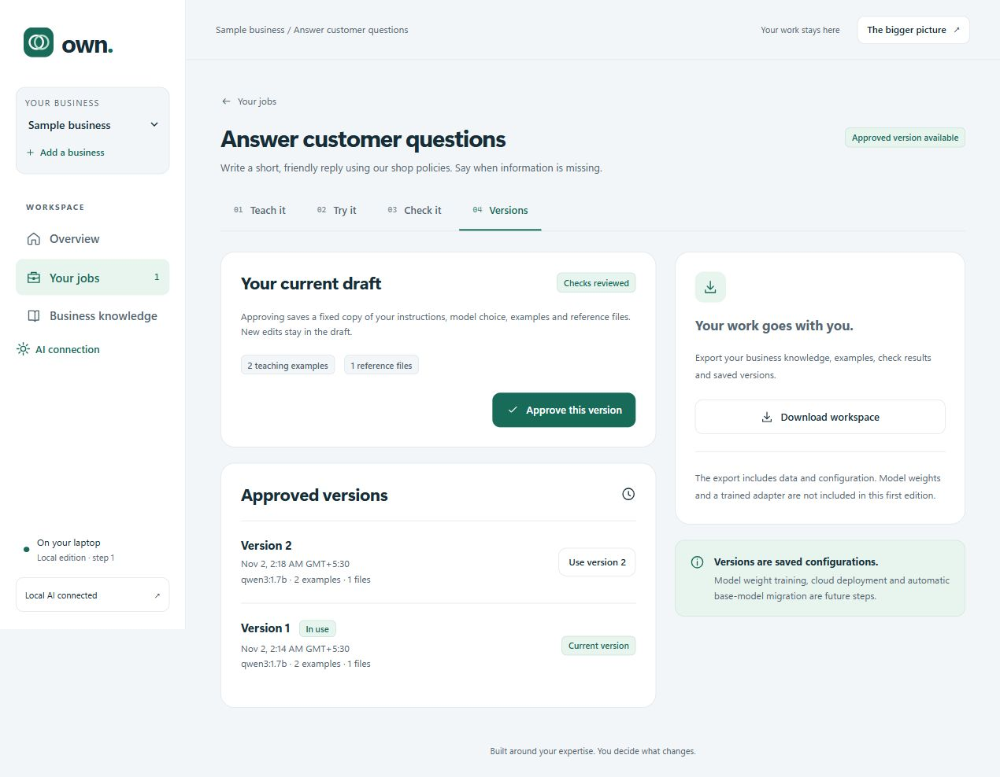

# Own — your local business AI workbench

Local business AI with actual per-business model training. Describe a job, show examples, train a private model update, compare answers, then check and approve it.



This repository contains application source and documentation. Local business data, trained weights, credentials and downloaded models are excluded from Git. The current scope and remaining stages are in [NEXT_STEPS.md](NEXT_STEPS.md).

## Open it

1. Double-click **START.cmd** in this folder.
2. Own opens at **http://127.0.0.1:8765** in your browser.
3. Choose **Explore a sample business**, or enter your business name.

Python and the app dependencies were already available on the development laptop. On another machine, install Python 3.11 or later, then run **SETUP.cmd** once. Setup creates a local `.venv` and installs the requirements from PyPI. Keep this whole folder together.

## Try real AI

Open Ollama. In Own, select **AI connection**. If a model is missing, run **INSTALL LOCAL MODEL.cmd** once; the suggested `qwen3:1.7b` model downloads about 1.4 GB. Business requests use the local Ollama service at `127.0.0.1:11434`; the app has no paid API integration. You may choose another installed local model.

1. Open a job and select **Teach it**.
2. Choose the installed model, explain the job, and save instructions.
3. Add a good teaching example and business reference notes if useful.
4. Select **Try it**, type a short request, and choose **Try my AI**.
5. Read the actual answer. **Fix this answer** saves your preferred answer as a teaching example in the draft.
6. In **Check it**, add a different request and the answer you expect. Run checks and review each actual answer.
7. In **Versions**, approve the checked draft. Try the approved version, or return to an earlier approved version later.

The sample business uses fictional shop policies. Example request: “How many days does standard delivery take?” Expected policy: five working days. A separate check could ask “What is the return window?” Expected: 30 days from delivery, with a receipt. These are demonstrations, not actual business policies.

## What works now

- Multiple local workspaces and general-purpose jobs.
- Persistent SQLite storage; no account needed.
- Instructions, teaching examples and corrections.
- UTF-8 `.txt`, `.md` and `.csv` source files, or pasted reference notes.
- Real locally installed Ollama model responses.
- Bounded keyword retrieval with visible supplied passages.
- Separate check examples, background check runs and manual review.
- Immutable approved configuration snapshots, explicit approval and switching versions.
- ZIP data/configuration export including teaching-only training JSONL and separately held-out checks.
- Example editing with conflict detection; frozen datasets and recorded permission/provenance.
- Actual CPU LoRA training using a pinned shared SmolLM2 base, with separate adapters for each business job.
- Real training steps, cancellation, restart recovery and failure reporting.
- Saved-adapter reload and before/after answers on held-out checks, with human review.
- Trained-adapter serving in Try it, existing check/approval/version controls, and model export with an independent runner.

## Train your business AI

1. In **Teach it**, add at least **3 correct teaching examples**. Use **Review or edit all examples** to improve them.
2. In **Check it**, add at least **1 different request** and its expected answer. These checks never enter the training loop.
3. Open **Train it**. Choose **Set up local training** once. This installs isolated CPU tools and downloads the public starter model (about 270 MB plus dependencies; allow about 2 GB of disk space).
4. Choose **Train my AI**, review the counts and confirm permission. Training runs on this laptop; no business data is uploaded and there is no provider charge.
5. Keep Own running. You may leave the tab and return; actual training progress is saved. **Stop training** keeps examples and earlier versions safe.
6. Compare the real answers before and after training. Both use the identical base and instructions, without teaching examples or reference notes in the prompt. Mark each trained answer **Looks right** or **Needs work**.
7. If every answer looks right, choose **Use this training**. This changes the draft. Try it, run **Check it**, and approve a version in **Versions** before using it for approved requests.
8. **Download trained model** includes actual adapter weights, frozen data, checks, provenance, permission, configuration and a standalone runner. The public base weights are downloaded separately once. Extract the ZIP and follow its README; no Own server or paid API key is required.

This is real weight training with a **small English starter model**, `HuggingFaceTB/SmolLM2-135M-Instruct`, revision `12fd25f77366fa6b3b4b768ec3050bf629380bac` (Apache-2.0). It has limited ability and may be less capable than the existing 1.7B Ollama model. Three examples only let you try the lifecycle; use substantially more varied examples and independent checks before relying on it. Training loss measures fit to teaching data, not accuracy. Stronger-model GPU training is a later stage.

The installer uses Windows extended-length paths rather than changing system settings. All training tools, caches, datasets and model artifacts stay under ignored `data/training/`. Nothing is installed into global Python. Setup needs the internet; training and inference load the local model offline after setup.

## Full YC scope and the next stages

The system is industry-independent. `PRODUCT.md` records the complete direction and architecture.

| YC capability | This edition | Next implementation |
|---|---|---|
| Workflows become evaluations | Jobs and separate check examples; human reviews | Rich rubrics, metrics, independent datasets and larger evaluation batches |
| Expertise becomes training data | Reviewed examples, corrections, consent/provenance and frozen datasets | Richer curation and bulk imports |
| Improve company-owned models | Actual isolated CPU LoRA training and saved adapters | Larger models on approved GPU providers |
| Production failures drive improvement | Persisted answers and manual corrections | Failure diagnosis, fix comparison and rollout monitoring |
| Control changes | Approved configuration snapshots and rollback | Deployment approvals, canary releases and trained-model rollback |
| Run where the customer chooses | Local workbench, adapter serving and independent CPU runner | Managed customer-cloud and on-prem deployment |
| Retain ownership | Portable data, real adapter weights and exact base identity/license | Broader serving formats and deployment packages |
| Carry learning to new base models | Explicit model choice and saved examples | Retrain/evaluate/migrate with compatibility checks |
| Optional frontier intelligence | No external provider calls | Explicit provider policies, credentials and spending approval |

Cloud GPU training, automatic migration, external tool actions, PDF/Word parsing, billing and production multi-user security are **not implemented**. A workspace data export is distinct from the trained-model download. A small local model is a development tool; quality must be measured for each business task.

## Data and privacy

Data lives in `data/own.sqlite3` beside this README. Back it up with the app stopped, or use the workspace ZIP export for a portable copy. The app binds only to `127.0.0.1`; do not expose it to the internet. Workspaces separate records and retrieval within one owner's app. They are not production authentication or authorization boundaries.

There is no encryption or access control between people using the same Windows account. Use sample or non-sensitive data while production security is developed. No analytics, remote fonts or paid API calls are built in. The app does not execute instructions as tools or send email. Supplied source passages are not automatically verified citations.

Exports include business data; keep them private. Training JSONL excludes held-out checks. Workspace ZIPs contain data/configuration; trained-model ZIPs additionally contain actual adapter weights and a runner. Base weights are obtained separately under the stated license. No export import flow is included yet.

## Limits and recovery

- 30 workspaces, 100 jobs per workspace, 40 files per workspace.
- UTF-8 files up to 1 MB and 200,000 characters each. PDFs and Word files are rejected with guidance.
- 200 examples per job; up to 10 checks in a local check run.
- Recent 20 answers and 10 evaluation runs displayed/exported per job, plus all examples, files and approved versions. The database retains older records.
- One model operation at a time. Training occupies the local inference slot. A model response may take up to three minutes; keep tasks short.
- Starter training uses 8 passes, one example per step, rank-8 LoRA, assistant-only loss and at most 384 tokens per full teaching conversation. Long examples fail with guidance; nothing is silently trimmed. Each run has a two-hour learning limit.
- Starter requests allow 2,048 input tokens and 100 output tokens. Limited outputs are rejected rather than silently returned as complete answers.
- At most three matching text passages and two teaching examples enter an Ollama request. Trained-model requests use the learned adapter and reference passages, without pasted teaching examples. This is keyword retrieval, not semantic search.
- Changing a job, teaching example, source file or check example requires fresh checks before approving. The draft does not overwrite an approved version.
- If Own stops, reopen START.cmd. If Ollama stops, open it and check the connection. A browser refresh reconnects a changed local session.

For a visible terminal server, run `python run.py --no-browser`. Press Ctrl+C to stop it. START.cmd normally runs the server in the background; its errors are written to `data/server.log`. Closing the browser does not stop that background server. Restart Windows or stop the specific `pythonw.exe run.py` process in Task Manager when you need to stop it. A dedicated app shutdown control is a future convenience feature.

## Developer checks

Install test tooling with `python -m pip install -r requirements-dev.txt` if needed, then:

```text
python -m unittest discover -s tests -v
node --check web/app.js
node --check web/training.js
```

Tests use temporary SQLite databases and a controlled model transport. They do not download models, spend money or establish real-model quality. Actual model availability and browser checks are recorded separately in `VERIFICATION.md`.

## Technical references

- [Ollama chat API](https://docs.ollama.com/api/chat)
- [Ollama installed model API](https://docs.ollama.com/api/tags)
- [Suggested small model](https://ollama.com/library/qwen3:1.7b)
- [Original YC request](https://www.ycombinator.com/rfs)
